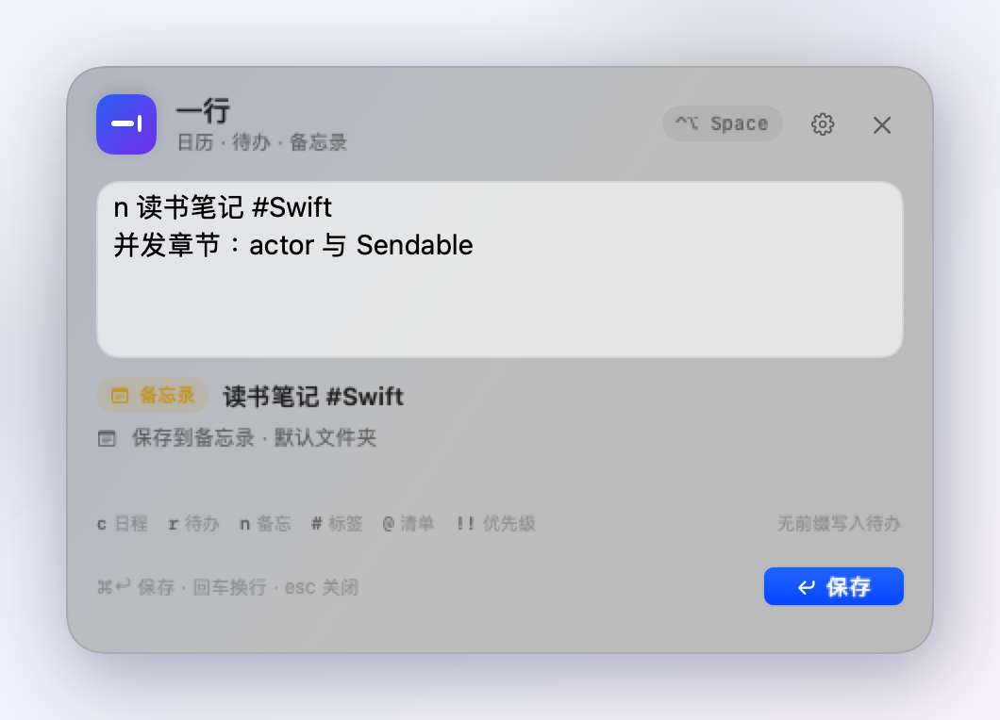
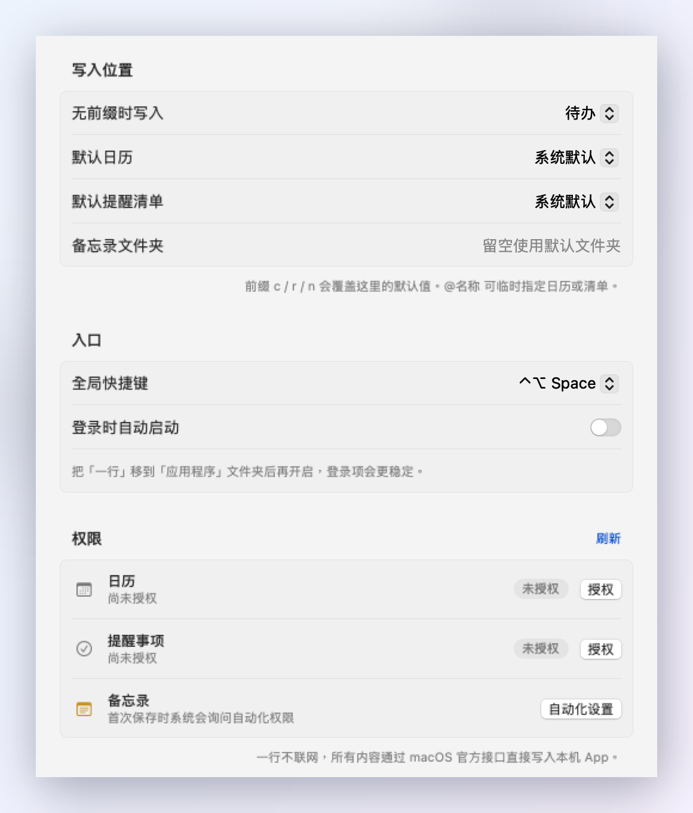

# 一行（OneLine）

> 一个常驻 macOS 菜单栏的快速记录工具：**一种语法，写入日历、待办、备忘录。**

**下载**：[最新 Release](../../releases/latest) · **源码**：当前仓库

<p align="center">
  
</p>

一行把“随手记一下”压缩成一次输入：在菜单栏或全局快捷键呼出输入框，用 `c` / `r` / `n` 选择目的地，日期、时间、清单、标签和优先级用同一套写法表达。数据全部通过 macOS 官方接口写进本机 App，不联网。

## 功能

- **菜单栏常驻**：不占 Dock，点击图标或按 `⌃⌥Space` 随时呼出。
- **一种语法，三个目的地**：`c` 日程、`r` 待办、`n` 备忘录；无前缀时写入设置中的默认类型。
- **自然语言时间**：支持“明天 14:00”“下周一 10点”“每周五”“2小时”“全天”等写法。
- **清单与标签**：`@工作` 指定日历或提醒清单，`#评审` 自动追加标签。
- **优先级**：待办支持 `!` / `!!` / `!!!`。
- **历史记录**：本机保留最近 20 条成功写入，菜单栏「最近记录」显示最近 5 条，可点击回填，也可清空。
- **设置**：默认日历、默认清单、备忘录文件夹、快捷键、登录时启动、权限状态。
- **系统原生**：EventKit 写入日历与提醒事项；AppleScript 自动化写入备忘录；Carbon 注册全局快捷键；SMAppService 管理登录项。

> 首次使用时不会立刻弹权限框；第一次真正写入某类数据，或点击设置里的「授权」时，才会向 macOS 申请对应权限。

## 安装与启动

从 [Releases](../../releases/latest) 下载 `OneLine-1.0.0.zip`，解压得到 `一行.app`。从源码构建时，产物在本机 `dist/一行.app`（`dist/` 不纳入 Git）。

1. 把 `一行.app` 拖进「应用程序」文件夹（推荐；登录项会更稳定）。
2. 首次打开：双击即可。若系统提示“无法验证开发者”，在 **系统设置 › 隐私与安全性** 中点击「仍要打开」，或右键 App 选择「打开」。
3. 菜单栏出现“方框 + 铅笔”图标。点击图标，或按 `⌃⌥Space` 呼出输入面板。
4. 第一次保存日程/待办/备忘录时，按提示授予权限。

最低系统版本：**macOS 14 Sonoma**。当前 Release 为 Apple Silicon（arm64）构建；Intel Mac 请从源码构建。构建时使用 macOS 27 / Xcode 27.1 / Swift 6.4。

## 使用方法

### 一个例子

```
c 产品评审 明天 14:00-15:00 @工作 #评审
```

按 `⌘↩` 保存后，会在「工作」日历中创建：

- 标题：产品评审
- 时间：明天 14:00–15:00
- 备注：`#评审`

三种目的地：

| 前缀 | 目的地 | 例子 |
|---|---|---|
| `c` | 日历 | `c 产品评审 明天 14:00-15:00 @工作` |
| `r` | 提醒事项 | `r 买牛奶 明天 18:00 @购物 !!` |
| `n` | 备忘录 | `n 读书笔记 #Swift` |

前缀完整写法：

- 日程：`c` / `cal` / `calendar` / `日程:` / `日历:` / `会议:` / `📅`
- 待办：`r` / `todo` / `remind` / `reminder` / `待办:` / `提醒:` / `✅` / `[ ]` / `- [ ]`
- 备忘：`n` / `note` / `memo` / `备忘:` / `备忘录:` / `笔记:` / `📝`

英文前缀可以用空格或冒号分隔；中文前缀需要冒号（避免把标题开头的“会议”误当成类型）。类型前缀也可以单独占第一行，内容从第二行开始。

### 输入框

- `⌘↩` 保存；`esc` 关闭。
- 支持多行：第一行是标题，其余行作为备注（日程/待办）或正文（备忘录）。
- 输入过程中实时显示解析结果；标题、时间、清单、标签、优先级会同步预览。
- 保存成功后面板保持打开，方便连续记录；输入框会清空。再按 `esc` 关闭即可。

### 全局快捷键

默认 `⌃⌥Space`。在 **设置 › 入口 › 全局快捷键** 中可切换：

- `⌃⌥Space`
- `⌃⌘Space`
- `⌥⇧Space`
- `⌃⇧Space`
- 关闭

如果快捷键被其他 App 占用，换一个即可；菜单栏图标始终可用。

## 统一语法

```
[类型] 标题 [日期/时间] [@日历或清单] [#标签] [!优先级]
```

各部分的顺序不限，解析器会把识别到的片段从标题中移除。

| 输入 | 写入 |
|---|---|
| `c 产品评审 明天 14:00-15:00 @工作 #评审` | 日历「工作」，明天 14:00–15:00 |
| `r 买牛奶 明天 18:00 @购物 !!` | 清单「购物」，明天 18:00，中优先级 |
| `n 读书笔记 #Swift`<br>`并发章节：actor 与 Sendable` | 备忘录，标题「读书笔记 #Swift」，正文为第二行 |
| `c 周会 下周一 10:00` | 下周一 10:00 |
| `c 团建 后天 全天` | 后天全天日程 |
| `r 交房租 每月1号` | 每月 1 号全天待办 |
| `r 吃药 每天 8:00` | 每天 8:00 的待办，并设置到点提醒 |
| `c 体检 11月5日 09:30` | 11 月 5 日 09:30 |
| `c 夜班 明天 23:00-1:00` | 明天 23:00 到次日 01:00 |
| `c 评审 @"工作 日历" 明天` | 指定名称含空格的日历 |
| `r 发邮件给 a@b.com @工作 #办公` | `a@b.com` 不会被误认为清单 |

### 时间与日期

支持：

- 相对日期：`今天`、`明天`、`后天`、`大后天`、`昨天`、`前天`、`3天后`。
- 时段词：`今晚`、`明早`、`明天下午`、`明天晚上`。
- 星期：`周一`、`下周三`、`下下周五`、`星期日`。以**周一**为一周开始。
- 绝对日期：`2026-10-28`、`2026/10/28`、`2026年10月28日`、`10月28日`、`10/28`、`28号`。
- 时间：`14:00`、`14:00-15:00`、`下午3点`、`下午3点半`、`晚上8点`、`9:00 到 10:30`。
- 时长（仅日程）：`2小时`、`90分钟`、`半小时`、`1个半小时`。
- 全天：`全天`。
- 重复：`每天`、`每周五`、`每月1号`、`每年10月1日`。

识别规则：

- 只写时间不写日期时，选最近一次未来时间；今天已过则排到明天。
- 只写日期不写时间：日程为全天；待办为全天截止。
- 写具体时间的待办，会自动加一个“到点提醒”；只写日期的待办不额外加闹钟。
- 没写日期和时间的日程：默认今天全天，并在预览中提示。
- 没写任何时间的待办：进入收件箱（无截止时间）。
- 不带年份的 `10月28日` 若已过去，会顺延到明年；`28号` 若已过去，会顺延到下个月。
- `3点` 默认按下午 15:00 处理；`7–11点` 按上午，`13–23点` 按 24 小时制；凌晨时间请写 `凌晨3点`。
- `明天下午` 默认 14:00，`今晚` / `明天晚上` 默认 20:00，`明早` 默认 09:00。
- `每周` 不写星期几时，以今天为锚点；如果今天的时间已过，就从下周开始。
- 只写时长不写开始时间时，日程从当前时间（按 5 分钟取整）开始。
- 重复规则目前只支持“一直重复”，不支持结束次数/结束日期和间隔（如“每两周”）。

### 清单与标签

- `@工作`：日程写入名为「工作」的日历，待办写入名为「工作」的清单。
- 名称中有空格：`@"工作 日历"`。
- 匹配时先精确匹配，再模糊匹配；找不到会回退到设置中的默认位置，并在预览/结果中提示。
- `#标签`：日程和待办会追加到备注末尾；备忘录不解析标签，原样保留内容。
- 标签/清单前需要有空格或中文标点，避免把邮箱、URL 片段误识别为清单/标签。

### 优先级

只对提醒事项生效：

| 写法 | 优先级 |
|---|---|
| `!` | 低 |
| `!!` | 中 |
| `!!!` | 高 |

### 备忘录的特殊规则

- 第一行是笔记标题，后续行是正文。
- 不解析日期、标签、`@清单` 和优先级，内容原样保存。
- 默认写入备忘录的默认文件夹；可在设置中指定文件夹名称（顶层文件夹）。
- 如果指定的文件夹不存在，会退回默认文件夹，并在结果中提示。
- macOS 没有公开的 Notes 写入 API，这里使用 Apple 官方的 **AppleScript 自动化** 接口；第一次写入会请求“控制备忘录”的权限。

<p align="center">
  
</p>

## 设置

<p align="center">
  
</p>

- **写入位置**：无前缀时的默认类型、默认日历、默认提醒清单、备忘录文件夹。
- **入口**：全局快捷键、登录时自动启动。
- **权限**：查看日历/提醒事项授权状态，直接授权或跳转系统设置；备忘录自动化设置入口。
- **登录项**：通过 `SMAppService` 注册；建议先把 App 放到「应用程序」文件夹。若系统要求批准，会提示到“系统设置 › 通用 › 登录项”中允许。

## 权限与隐私

需要三类系统权限：

1. **日历**：读取可用日历列表，写入日程。请求完整访问（Full Access）。
2. **提醒事项**：读取提醒清单，写入待办。请求完整访问（Full Access）。
3. **自动化 › 备忘录**：仅用于通过 AppleScript 创建笔记。

- 一行没有网络代码，不上传任何内容，也没有分析/统计。
- 所有数据直接写入本机日历、提醒事项和备忘录。
- 本机 `UserDefaults` 保存设置和最近 20 条成功记录（含原始输入，用于“最近记录”回填）；可在菜单栏「最近记录 › 清空最近记录」中清除。
- 权限路径：**系统设置 › 隐私与安全性 › 日历 / 提醒事项 / 自动化**。
- App 使用 ad-hoc 签名；每次重新构建并替换 App 后，系统可能要求重新授权。正式分发建议使用 Developer ID 签名并公证。

## 开发

### 环境

- macOS 14+
- Xcode 15+（本项目在 Xcode 27.1 / Swift 6.4 下构建验证）
- 无第三方依赖

### 构建

```bash
./scripts/build-app.sh
```

脚本会：

1. `swift build -c release`；
2. 组装 `dist/一行.app`，复制 Info.plist 与图标；
3. 使用 ad-hoc 签名并带上 Apple Events 自动化 entitlement；
4. 执行 `--self-check`，检查 Info.plist、bundle、EventKit 状态和快捷键可用性。

也可以直接用 Xcode 打开 `Package.swift` 开发。

### 测试

```bash
./scripts/test.sh
```

当前 51 个解析器单元测试，覆盖日期、时间、跨午夜、下周一、重复规则、标签/清单、非法日期、备忘录多行等场景。

### 目录

```
Sources/
  OneLineCore/          # 纯 Swift 解析器（可单测，不依赖 AppKit）
    CaptureModels.swift
    CaptureParser.swift
    DateExpressionScanner.swift
  OneLine/
    App/                # 菜单栏、面板、全局快捷键、AppDelegate
    UI/                 # SwiftUI 面板与设置
    Services/           # EventKit、AppleScript、权限、登录项
    Storage/            # 设置与历史
    SelfCheck.swift
    SnapshotRenderer.swift
Tests/OneLineCoreTests/
Resources/              # Info.plist、entitlements、AppIcon.icns
scripts/                # 构建与测试
docs/                   # README 配图
dist/一行.app           # 本地构建产物（不纳入 Git）
```

### 设计说明

- **解析与写入分离**：`OneLineCore` 只做纯文本解析，输出 `ParsedCapture`；写入层只消费结构化结果，便于测试和替换。
- **权限按需申请**：不在启动时打扰用户；设置页可以提前授权，保存时也会自动补齐。
- **菜单栏优先**：`LSUIElement` + `NSStatusItem` + 无边框浮动 `NSPanel`；关闭面板后主动归还焦点给上一个 App。
- **AppleScript 兜底**：备忘录采用 HTML 正文写入，标题/正文/文件夹名都做 AppleScript 字符串转义；文件夹不存在时自动退回默认文件夹。

## 已知限制

- 仅支持 macOS，且最低 14.0。
- 备忘录依赖自动化权限；企业 MDM 或安全策略可能禁止。
- 备忘录文件夹只按顶层名称查找；多账户下可能出现歧义。
- 重复规则暂不支持结束条件、间隔和“每两周”等复杂规则。
- 不支持中文数字时间（如“下午三点”），请使用阿拉伯数字（`下午3点`）。
- 日程不会自动添加闹钟；待办只有带具体时间时才会自动添加“到点提醒”。
- 暂不支持附件、地点、参会人、URL、子任务、提醒事项的“完成”状态。
- 登录项建议在 App 位于 `/Applications` 时开启。
- 目前为 ad-hoc 签名，适合本机个人使用；正式分发需自行配置 Developer ID 与公证。
